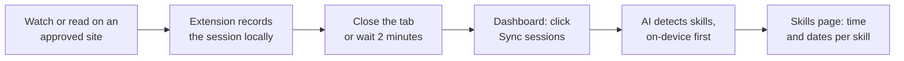

# SkillTrace Chrome extension: user guide

The SkillTrace extension records the videos, audio and articles you study on the websites you approve, such as YouTube. It then hands those sessions to your SkillTrace dashboard, where Firebase AI Logic works out which skills you learned and for how long.

> **Important:** the extension only collects. Your skills and the time spent on each one appear in the dashboard **after you click "Sync sessions"** (see [step 5](#5-sync-at-the-end-to-get-the-time-for-each-skill)). Until then, everything stays inside the extension on your computer.



## 1. Install the extension

1. Download `skilltrace-extension-v0.2.1.zip` from the [latest release](https://github.com/Kartavya1905/skilltrace-ai-hybrid/releases/latest) and unzip it into a folder you will keep (Chrome loads it from there).
2. Open `chrome://extensions` and turn on **Developer mode** (top right).
3. Click **Load unpacked** and select the unzipped folder.
4. Pin **SkillTrace AI** from Chrome's puzzle-piece menu so the popup is one click away.

The extension ID is always `kecllpafndpfocijmodnoilonglpkjcf`, so the dashboard finds it automatically.

> Updating from an older version? Remove the old copy in `chrome://extensions` first, then load the new folder. Your settings start fresh, so repeat step 2.

## 2. Turn it on

Click the SkillTrace icon to open the popup and set the switches:

| Switch                         | What to choose                                                                                                                                                |
| ------------------------------ | ------------------------------------------------------------------------------------------------------------------------------------------------------------- |
| **Learning activity tracking** | **On.** Nothing is recorded while this is off.                                                                                                                |
| **Pause tracking**             | Off. Turn it on whenever you want a break from tracking.                                                                                                      |
| **DEMO mode (short checks)**   | **Off** for real study. On only for a quick demo: engagement checks come much more often.                                                                     |
| **Detect skills from speech**  | Optional. When on, up to three 20-second clips are taken from the video itself (never the microphone), so what is _said_ also counts towards skill detection. |

## 3. Approve the sites you learn on

Tracking only works on sites you approve, one by one.

1. Open the site, for example `https://www.youtube.com`.
2. Open the popup and click **Allow tracking on this site**.
3. Chrome asks for permission for that site only. Click **Allow**.
4. The tab reloads and the button changes to **Tracking allowed on this site**.

The approved sites are listed in the popup, each with a **Remove** button.

## 4. Study as usual

- **Videos and audio:** play the video. Each video becomes its own session with its title and description. On YouTube:
  - only real watch pages count (`/watch`, live, embeds and Shorts), not the muted previews on the home page or in search
  - ads are never credited, and an ad break does not split the video into two sessions
  - videos shorter than 30 seconds are ignored
- **Reading:** articles with at least about 250 words are tracked by the sections you actually scroll through and read.
- **Engagement checks:** now and then a small **SkillTrace check-in** box asks "Are you still watching?" or "Still reading?". Click **I'm here, continue**. There is nothing to answer, and only ignoring the check affects credit: the unanswered time is marked unverified.

When you finish a video or article, **close the tab or move on to the next video**. A session becomes ready to sync when its tab is closed, or after 2 minutes without activity. The popup shows **N session(s) ready to sync**.

## 5. Sync at the end to get the time for each skill

This is the step that turns recorded sessions into skills. **Do it at the end of every study session.**

1. In the popup, click **Open dashboard (skilltrace-hybrid-2026.web.app)** and sign in. Alternatively, open https://skilltrace-hybrid-2026.web.app/app/settings yourself.
2. Go to **Privacy & Settings → Websites (Chrome extension)**. You should see **Connected v0.2.1** and **N session(s) waiting**.
3. Click **Sync sessions**. The panel confirms, for example: _"Imported 2 session(s), 1 with speech transcribed."_
   - If speech detection is on, the clips are transcribed during the sync (on-device first) and then deleted. The audio is never uploaded to the database.
   - If your cloud setting is **Ask me each time** and on-device AI is unavailable, a prompt asks before anything goes to the cloud.
4. The dashboard then detects skills for each new session on its own. In **Sessions**, the badge changes from **Awaiting AI** to **AI classified**, along with where the AI ran (on-device or cloud).

Nothing reaches your dashboard until you sync. If you skip this step, your sessions just wait in the extension.

## 6. See your time and dates per skill

After the sync:

- **Sessions** lists every session with its title, source (**Chrome extension**), start date and time, and the skills detected. Use **Correct skills** if a detection is wrong; your correction is never overwritten.
- **Skills** shows the time attributed to each skill. Open a skill to see:
  - **Eligible learning**, **Involved time**, **Raw recorded** and **Revision**
  - **Learning history** by period
  - **Learning sessions**: each video or article with its date and the time it gave this skill, for example the Node.js tutorial in the JavaScript skill: _"11/24/2026 · 27s attributed (60% of 45s)"_ (the date follows your browser's format)
- **Skill Passport** lets you publish the skills you choose, with this evidence behind them.

A session that covers several skills splits its time between them (for example JavaScript 60% and Node.js 40%), so the totals across skills add up to the real time you studied.

## Privacy in short

- **Recorded:** page title, a privacy-preserving page ID, the address without its query string, the video description, media and scroll events, and, if you turned it on, short audio clips from the video itself.
- **Never recorded:** keystrokes, form fields, passwords, the clipboard, the microphone, the camera or your screen.
- **Where data stays:** everything sits in the extension's local storage until you click **Sync sessions**, and is deleted from the extension once the dashboard confirms it.

Full details: [docs/privacy.md](../../docs/privacy.md).

## Troubleshooting

| Problem                                        | Fix                                                                                                                             |
| ---------------------------------------------- | ------------------------------------------------------------------------------------------------------------------------------- |
| "Allow tracking on this site" is greyed out    | Turn on **Learning activity tracking** first. Chrome's own pages (`chrome://…`) can't be tracked.                               |
| The popup shows 0 sessions ready to sync       | Close the video's tab, or wait 2 minutes after it stops. Check that the site is in the approved list and tracking isn't paused. |
| Dashboard says "Not connected"                 | Open the dashboard from the popup's **Open dashboard** link, or paste the extension ID from the popup and click **Connect**.    |
| **Sync sessions** is greyed out                | Nothing is waiting yet; see the row above.                                                                                      |
| A session says **Queued (AI unavailable)**     | No AI was available at the time (offline, or cloud not allowed). Click **Retry detection** later.                               |
| A video got no skills ("not learning content") | It was too short or not educational. Use **Correct skills** in **Sessions** to set them yourself.                               |

## For developers

Build from source instead of using the release zip:

```bash
pnpm install
pnpm build:extension     # writes apps/extension/dist
```

Then load `apps/extension/dist` with **Load unpacked**. For a quick local demo, approve `localhost` and open `http://localhost:5310/lab/extension-demo.html` (run `pnpm dev` first). Release packaging and hosted dashboard origins are covered in [docs/deployment.md](../../docs/deployment.md).
